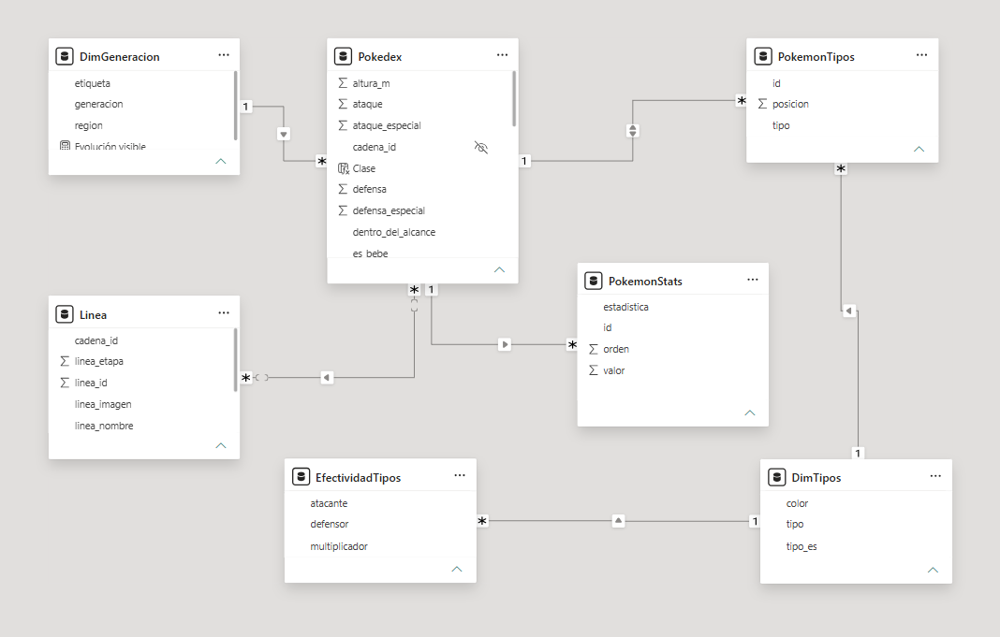

# Pokeboard MentDev

Dashboard interactivo en Power BI para explorar y analizar los Pokémon de las generaciones 1 a 3: un Pokédex con filtros y fichas, más un análisis de tipos, rankings y evoluciones. Los datos se obtienen de una API pública con Power Query.


> **Estado:** versión 1. La página Pokédex está completa; las páginas de análisis están en desarrollo (ver la [hoja de ruta](#hoja-de-ruta)).

## Objetivo

Proyecto personal para practicar el ciclo completo de un proyecto de datos: consumir una API, modelar los datos, escribir medidas en DAX y diseñar un dashboard con identidad propia. Elegí Pokémon porque sus datos son ricos y bien estructurados (estadísticas, tipos, generaciones, cadenas de evolución) y permiten plantear preguntas de análisis interesantes.

## Preguntas de análisis

1. ¿Qué tipo es el más fuerte y cuál el más equilibrado?
2. ¿Cuánto mejora un Pokémon al evolucionar? *(pregunta principal)*
3. ¿Quiénes son los mejores Pokémon y cambia el ranking si se excluyen los legendarios?

Además, una **calculadora de tipos**: dado un Pokémon (de uno o dos tipos), indica con qué tipos de ataque se le hace más daño.

## Qué incluye la versión 1

- Filtros por tipo, generación, clase (común, bebé, legendario o mítico) y nombre.
- Lista de Pokémon y ficha con imagen, tipos, generación, altura, peso, estadísticas base y línea evolutiva.
- Filtro para incluir o excluir legendarios y míticos.

## Datos

- **Fuente:** [PokéAPI](https://pokeapi.co/docs/v2), una API pública y gratuita que no requiere clave.
- **Alcance:** Pokémon 1 a 386 (generaciones 1 a 3). También se incluyen unas decenas de Pokémon de generaciones posteriores (formas bebé y evoluciones nuevas) para no truncar las líneas evolutivas. Quedan marcados con `dentro_del_alcance = falso` y no aparecen en la lista ni en los rankings.
- **Extracción:** funciones en Power Query (M) que consultan cuatro endpoints de la API: Pokémon, especies, cadenas de evolución y tipos. Son cientos de llamadas, por lo que los datos se cargan una vez y quedan guardados en el modelo, siguiendo la política de uso justo de la API.

## Modelo de datos



| Tabla | Contenido |
|-------|-----------|
| `Pokedex` | Una fila por Pokémon: estadísticas, tipos, generación, clase, etapa evolutiva, altura, peso e imagen |
| `PokemonTipos` | Tabla puente: una fila por combinación Pokémon-tipo |
| `DimTipos` | Nombre en español y color de cada tipo |
| `DimGeneracion` | Generaciones y regiones |
| `EfectividadTipos` | Multiplicador de daño de cada tipo atacante contra cada tipo defensor (18 × 18) |
| `PokemonStats` | Estadísticas en formato largo, para los gráficos de barras |
| `Linea` | Copia ligera de `Pokedex` para mostrar la línea evolutiva completa |

**Decisiones técnicas**
- Un Pokémon puede tener dos tipos, por eso existe la tabla puente `PokemonTipos`: así, al filtrar por un tipo aparecen los Pokémon que lo tengan como principal o secundario.
- La línea evolutiva se muestra con una relación varios a varios entre `Pokedex` y `Linea` por la cadena de evolución, con el filtro en una sola dirección.
- Las tablas auxiliares se crean en DAX y no en Power Query, para no volver a llamar a la API.
- Las formas bebé cuentan como etapa 1 (por ejemplo, Pichu), por lo que Pikachu queda en etapa 2.

## Código

- [Extracción y transformación (Power Query)](codigo/extraccion-power-query.md)
- [Modelo y DAX](codigo/medidas-dax.md)

## Lo que aprendí

- Consumir una API REST desde Power Query: endpoints, JSON (registros y listas) y buenas prácticas de uso.
- Aplanar datos anidados con una función recursiva (las cadenas de evolución).
- Modelar relaciones: tabla puente para el doble tipo, varios a varios controlado y dirección del filtro.
- DAX: columnas calculadas, tablas calculadas y medidas que dependen del contexto de filtro (`HASONEVALUE`, `SELECTEDVALUE`, `ALLSELECTED`).
- Depurar errores de nombres en ámbitos anidados en M.
- Diseñar un dashboard con identidad de marca, cuidando el contraste y la jerarquía visual.

## Limitaciones

- La calculadora de tipos mide únicamente la ventaja de tipo: no considera habilidades ni movimientos concretos.
- Se usan las estadísticas base de cada Pokémon, sin ajustes por nivel, naturaleza o equipamiento.
- Se usa la tabla de tipos actual (18 tipos, incluido Hada), incluso para Pokémon de generaciones anteriores a su introducción.
- Solo se incluye la forma por defecto de cada Pokémon (sin megaevoluciones ni formas regionales).

## Cómo abrir el proyecto

1. Descarga `powerbi/Pokedex_PowerBI_v1.pbix`.
2. Ábrelo con [Power BI Desktop](https://powerbi.microsoft.com/desktop/) (gratuito para Windows).
3. Los datos ya están cargados en el archivo. **No pulses "Actualizar"**: volvería a lanzar cientos de llamadas a PokéAPI, y su política de uso justo pide limitar la frecuencia de las peticiones.

## Estructura del repositorio

```
pokeboard-powerbi/
├── README.md
├── powerbi/
│   └── Pokedex_PowerBI_v1.pbix
├── capturas/
│   ├── pagina-pokedex.png
│   └── modelo-de-datos.png
└── codigo/
    ├── extraccion-power-query.md
    └── medidas-dax.md
```

## Hoja de ruta

- [x] Extracción de datos desde PokéAPI con Power Query
- [x] Modelo de datos
- [x] Página Pokédex: filtros, ficha, estadísticas y línea evolutiva
- [ ] Página de tipos: ¿cuál es el más fuerte y cuál el más equilibrado?
- [ ] Página de mejores Pokémon, con y sin legendarios
- [ ] Página de evoluciones: ¿cuánto mejora un Pokémon al evolucionar?
- [ ] Calculadora de tipos
- [ ] Portada, navegación y conclusiones

## Créditos y aviso legal

- Datos: [PokéAPI](https://pokeapi.co). Las imágenes se cargan desde el repositorio público [PokeAPI/sprites](https://github.com/PokeAPI/sprites); no se incluyen dentro del archivo.
- Proyecto educativo sin fines de lucro. Pokémon y sus nombres, personajes e imágenes son marcas y propiedad de Nintendo, Game Freak y The Pokémon Company. Este proyecto no está afiliado ni respaldado por ellos.

## Autor

Creado por **Luis Zevallos** · [MentDev]([https://www.facebook.com/profile.php?id=61582344438020]) · [LinkedIn]([www.linkedin.com/in/luis-zevallos-257764253])

